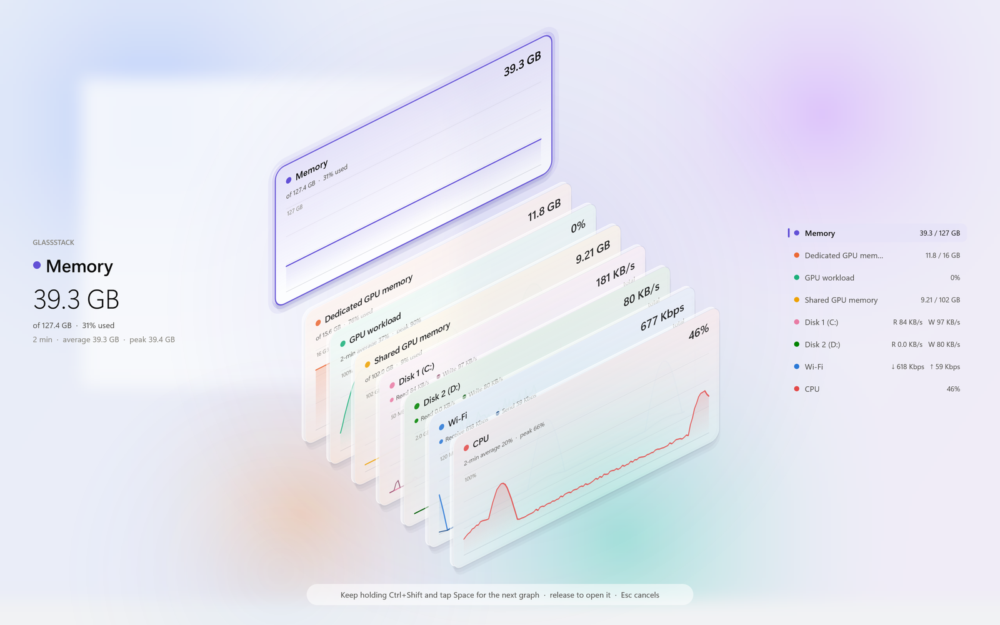
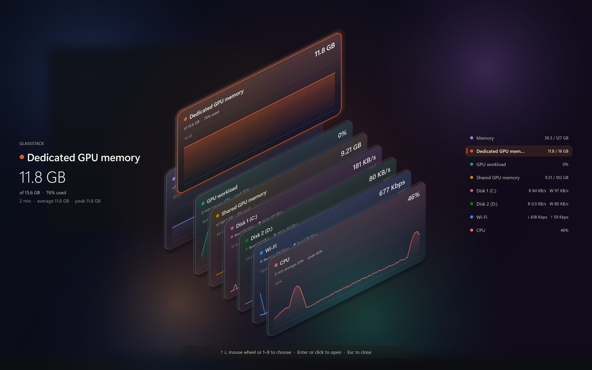
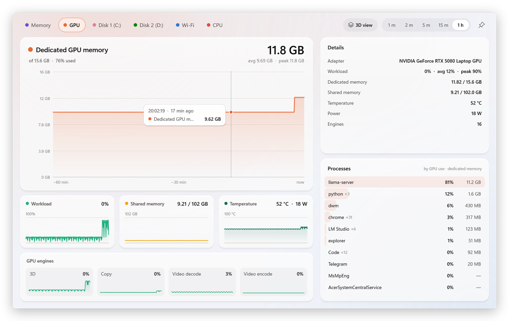
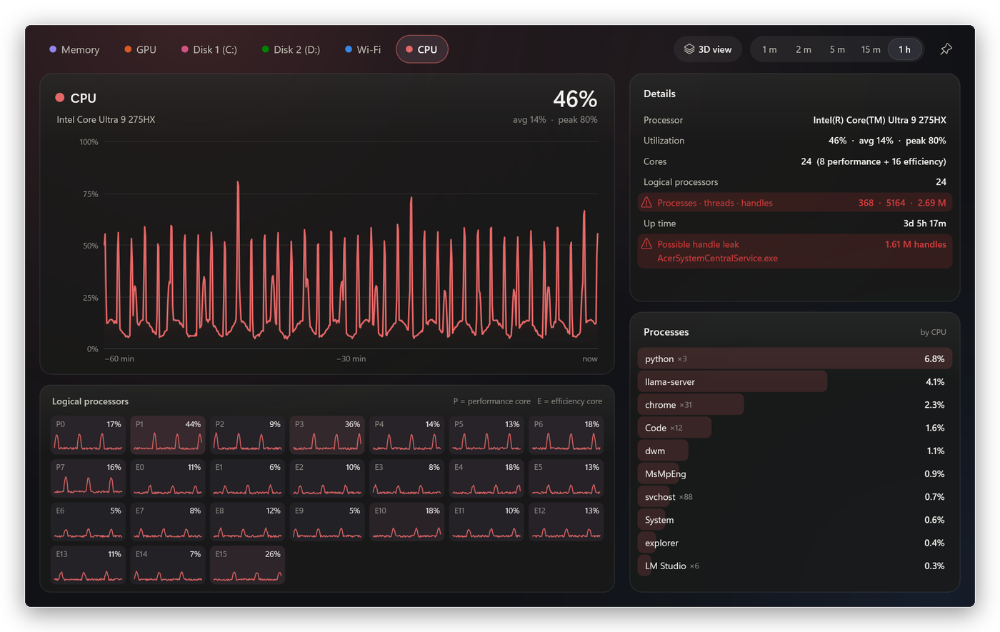
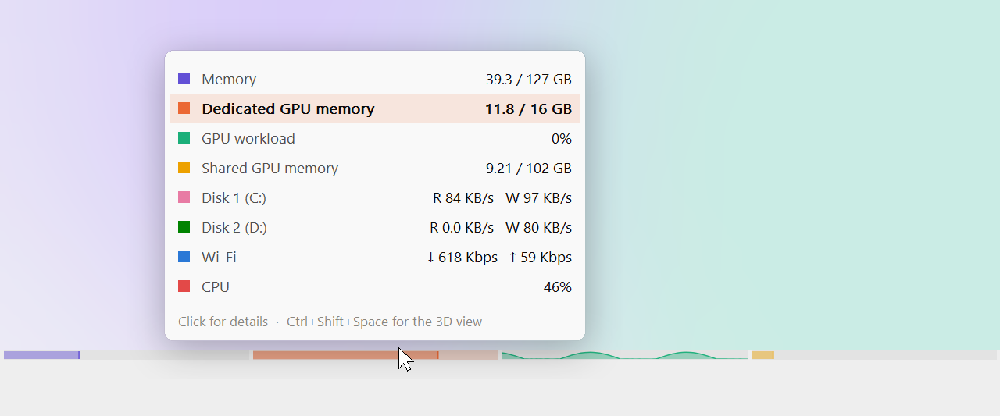
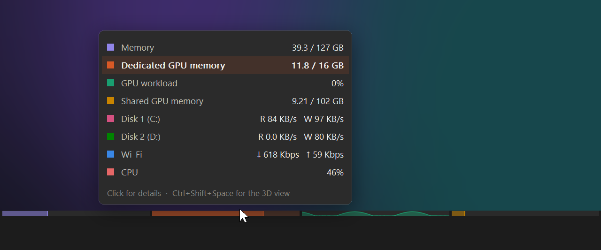
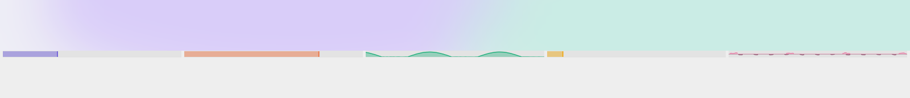

# GlassStack

**A tiny system monitor for Windows 11: a slim strip on the taskbar, a 3D overview on a hotkey, and detail windows that show what is behind every number.**

**Windows 11 için küçük bir sistem izleyici: görev çubuğunun üstünde ince bir şerit, kısayolla açılan 3B genel bakış ve her sayının arkasında ne olduğunu gösteren detay pencereleri.**

[English](#english) · [Türkçe](#türkçe)

| | Light | Dark |
|---|---|---|
| **3D overview** |  |  |
| **Detail window** |  |  |
| **Strip popup** |  |  |



*Screenshots are rendered by the program itself with made-up data (`GlassStack.exe --render-test`).*

---

## English

### Download and run

1. Download `GlassStack-<version>-win-x64.zip` from the [latest release](../../releases/latest).
2. Unzip it into any folder you like, for example `C:\Tools\GlassStack`.
3. Run `GlassStack.exe`.

That is all: one ~540 KB file, no installer and no runtime to install. Settings are written to `GlassStack.ini`
next to the exe. To start it with Windows, right-click the strip or the tray icon and tick *Start with Windows*.

The exe is not code-signed, so the first time Windows SmartScreen may say *"Windows protected your PC"*. Click
*More info*, then *Run anyway*. If you would rather not trust a downloaded exe, build it yourself (below); the
release exe is built from this source by GitHub Actions, and the build log is public.

Requirements: Windows 11 (Windows 10 works too, with square popup corners), x64.

### What is on screen

**Taskbar strip.** An 8-pixel strip stacked on the taskbar, one slot per metric, each in its own colour and without
text: memory, dedicated GPU memory, GPU workload, shared GPU memory, disk 1, disk 2, Wi-Fi, CPU. The memory slots
are fill gauges; the others are mini graphs of the last minutes, disk and network on a log scale. Its background
follows the taskbar's tint, and it hides itself while a full-screen app or game runs.

- Rest the pointer on a slot for a second: a popup shows every value, the one under the pointer highlighted
  (passing over the strip on the way to the taskbar shows nothing).
- Click a slot: opens that slot's detail window.
- Right-click: the GlassStack menu.

**3D overview.** A deck of frosted-glass cards, one per graph, each showing the last 2 minutes. The focused card
rises straight up out of its slot; the panel on the left repeats it in large type, the list on the right shows
every value.

**Detail (section) window.** The chosen graph in large, with every related graph of its area, a details panel and
the processes behind the numbers. Click any small graph (GPU engines included) to make it the large one; each
section remembers its choice, and the section's slot on the strip shows that graph too.

| Section | Large graph | Also shown | Processes sorted by |
|---|---|---|---|
| Memory | memory in use | committed memory, cache, a handle-leak warning | memory |
| GPU | dedicated GPU memory | workload, shared memory, temperature and power, every GPU engine | GPU use and video memory |
| Disk 1 / Disk 2 | read + write speed | active time, response time, model and size | I/O (all disks) |
| Wi-Fi | receive + send | signal, ping, link speed, SSID, address | open TCP connections |
| CPU | CPU busy time | every core, P-cores and E-cores apart | CPU |

### Keys

**Ctrl+Shift+Space** (can be changed, see `Hotkey` below):

- Press it and keep **Ctrl+Shift** held: the overview appears.
- Still holding Ctrl+Shift, tap **Space**: the next card comes forward.
- Let go of all keys: the focused card's detail window opens.
- A quick tap: opens the section you looked at last, without the overview.
- **Esc** while the overview is up: closes it.

Overview opened from the tray icon or the "3D view" button: **arrow keys, Tab, Space, the mouse wheel or 1-9**
choose a card, **Enter** or a click opens it, **Esc** or a click outside closes it.

Detail window: **1-6**, **Left/Right** or **Tab** switch sections, **Esc** or **Ctrl+W** closes, the mouse wheel
scrolls the process list, a right-click on a process offers *End task*, *Open file location* and *Copy name*. The
buttons at the top choose the time range (1 minute to 1 hour), open the 3D view and pin the window on top.
Pointing at the large graph shows the exact value and time of any moment.

### Tray menu

Click the tray icon for the overview; right-click it (or the strip) for: 3D overview, Details (each section), Show
taskbar strip, Strip height, which physical disk is Disk 1 / Disk 2, Network units (bits or bytes), Window theme
(follow Windows, light, dark), Start with Windows, Edit settings..., Exit GlassStack.

### Settings

`GlassStack.ini` next to the exe. The menu writes most of them; anything changed by hand is applied within
2 seconds of saving the file.

| Key | Default | Meaning |
|---|---|---|
| `Hotkey` | `Ctrl+Shift+Space` | Shortcut for the overview, e.g. `Ctrl+Alt+M`, `Win+Shift+G` |
| `Graphs` | `mem,gpumem,gpu,gpushared,disk1,disk2,wifi,cpu` | Which graphs the strip and the overview show, in this order |
| `ShowStrip` | `1` | `0` hides the taskbar strip |
| `StripHeight` | `8` | Strip height in pixels at 100 % scale (2-24) |
| `StripPixelsPerSecond` | `2` | How fast the strip's mini graphs scroll (1-8) |
| `Disk1`, `Disk2` | `0`, `1` | Physical disk numbers (as in Disk Management) |
| `NetworkUnits` | `bits` | `bits` (Kbps, Mbps) or `bytes` (KB/s, MB/s) |
| `SampleMs` | `1000` | Sampling interval in milliseconds (250-5000) |
| `PingHost` | `1.1.1.1` | Address pinged for the latency graph |
| `Theme` | `auto` | `auto`, `light` or `dark` for the overview and the detail window |
| `ViewerLingerSeconds` | `60` | How long the detail window's process stays after closing, so that reopening is instant |
| `UseNvml` | `1` | Read NVIDIA power through the driver's NVML library |
| `SectionRangeSeconds` | `120` | Time range of the detail window (60, 120, 300, 900 or 3600) |
| `SectionPinned` | `0` | Keep the detail window on top |
| `SectionCharts` | `mem,gpumem,disk1,disk2,wifi,cpu` | The large graph of each section (set by clicking a small graph) |
| `LastGraph`, `SectionWindow` | | Remembered automatically |
| `Diag` | `0` | `1` writes a per-minute cost log of the resident part to `GlassStack-diag.txt` |

### How light it is

Measured on a Core Ultra 9 275HX laptop, 2560x1600 at 150 %:

| Part | Runs | Memory (private) | CPU |
|---|---|---|---|
| Resident: sampler, strip, tray icon, hotkey | always | about 2 MB | 3-8 ms per second (under 1 % of one core) |
| Detail window | while open, plus 60 s | about 45 MB | about 30 ms per refresh, once a second |
| 3D overview | only while on screen | about 25 MB | about 70 ms to open; animation frames cost almost nothing |

Only the resident part runs all the time. The windows run in separate short-lived processes that draw in software
(no GPU driver memory) and hand their pictures to the Windows compositor, which animates them on the GPU; when a
window closes, its process exits and every byte goes back.

### Good to know

- **CPU percentage.** GlassStack shows how busy the processors were (the classic "% Processor Time"). Task
  Manager's CPU column shows "% Processor Utility", which also counts turbo frequency, so it can read higher under
  load and lower when the CPU is throttled.
- **Units.** Disk speeds are in bytes per second, network speeds in bits per second unless you choose bytes, both
  decimal. Memory sizes are binary GB (GiB), as in Task Manager.
- **Handle-leak warning.** The memory section warns when a process holds an unusual number of handles (a vendor
  service holding a million handles can keep gigabytes of kernel memory in use).
- **Ending tasks** works for your own processes; system services need an elevated Task Manager.

### Building from source

You need Visual Studio 2022 (or newer) or its free
[Build Tools](https://visualstudio.microsoft.com/downloads/#build-tools-for-visual-studio-2022) with the
*Desktop development with C++* workload (it includes a Windows SDK). No other libraries.

```
git clone https://github.com/erenciracioglu-dotcom/GlassStack.git
cd GlassStack
build.bat
```

The result is `bin\GlassStack.exe` (static runtime, one file). `build.bat GlassStack-dev` builds under another
name, so a running copy does not block the build. The source is one translation unit (`src\GlassStack.cpp`) with a
header per part: `gs_sampler.h` (measurements), `gs_bar.h` (strip and popup), `gs_resident.h` (tray, hotkey,
settings, starting the windows), `gs_overlay.h` (3D overview), `gs_section.h` (detail window), `gs_detail.h`
(process lists and other details), `gs_viewer.h` (window processes and tests).

### Command line

```
GlassStack.exe                          start (a second start opens the overview of the running copy)
GlassStack.exe --quit                   close the running copy
GlassStack.exe --selftest <file>        report what the sampler finds on this PC and what each query costs
GlassStack.exe --render-test <dir>      render every view to PNG files with made-up data
GlassStack.exe --bench <file> <mt> [hw] memory and CPU of the windows, drawn off screen (needs a running copy)
```

The README screenshots come from `--render-test` followed by `python tools\readme_shots.py <dir> docs\screenshots`.

### Removing it

Right-click the strip or the tray icon, untick *Start with Windows*, choose *Exit GlassStack*, then delete the
folder. Nothing else is left behind.

---

## Türkçe

### İndirip çalıştırma

1. [Son sürümden](../../releases/latest) `GlassStack-<sürüm>-win-x64.zip` dosyasını indir.
2. İstediğin bir klasöre çıkar, örneğin `C:\Tools\GlassStack`.
3. `GlassStack.exe`'yi çalıştır.

Bu kadar: yaklaşık 540 KB'lık tek bir dosya; kurulum yok, ayrıca kurulacak bir çalışma ortamı yok. Ayarlar exe'nin
yanındaki `GlassStack.ini` dosyasına yazılır. Windows ile başlaması için şeride veya tepsi simgesine sağ tıklayıp
*Start with Windows*'u işaretle.

Exe dijital olarak imzalı olmadığı için ilk açılışta Windows SmartScreen *"Windows bilgisayarınızı korudu"*
diyebilir: *Ek bilgi*, ardından *Yine de çalıştır*. İndirilen bir exe'ye güvenmek istemezsen kendin
derleyebilirsin (aşağıda); sürümdeki exe de bu kaynak koddan GitHub Actions ile derlenir ve derleme kaydı herkese
açıktır.

Gereksinimler: Windows 11 (Windows 10'da da çalışır, popup köşeleri yuvarlak olmaz), x64.

### Ekranda ne var

**Görev çubuğu şeridi.** Görev çubuğunun üstüne yerleşen 8 piksellik bir şerit; her ölçüm için kendi renginde,
yazısız bir bölme: bellek, ayrılmış GPU belleği, GPU yükü, paylaşılan GPU belleği, disk 1, disk 2, Wi-Fi, CPU.
Bellek bölmeleri doluluk göstergesi, diğerleri son dakikaların küçük grafikleri (disk ve ağ logaritmik ölçekte).
Arka planı görev çubuğunun rengini izler; tam ekran bir uygulama veya oyun açıkken kendini gizler.

- İmleci bir bölmenin üzerinde bir saniye tut: tüm değerleri gösteren bir popup açılır, imlecin altındaki
  vurgulanır (görev çubuğuna giderken şeridin üzerinden geçmek popup açmaz).
- Bir bölmeye tıkla: o bölmenin detay penceresi açılır.
- Sağ tık: GlassStack menüsü.

**3B genel bakış.** Her grafik için bir buzlu cam kart; her biri son 2 dakikayı gösterir. Seçili kart kendi
yuvasından dümdüz yukarı çıkar; soldaki panel onu büyük yazıyla tekrarlar, sağdaki liste tüm değerleri gösterir.

**Detay penceresi.** Seçilen grafik büyük olarak; yanında o alanın tüm ilgili grafikleri, bir ayrıntı paneli ve
sayıların arkasındaki işlemler. Herhangi bir küçük grafiğe (GPU motorları dahil) tıklayınca o, büyük grafik olur;
her bölüm seçimini hatırlar ve şeritteki bölmesi de o grafiği gösterir.

| Bölüm | Büyük grafik | Ayrıca | İşlem sıralaması |
|---|---|---|---|
| Bellek | kullanılan bellek | ayrılmış (commit) bellek, önbellek, handle sızıntısı uyarısı | bellek |
| GPU | ayrılmış GPU belleği | yük, paylaşılan bellek, sıcaklık ve güç, tüm GPU motorları | GPU kullanımı ve video belleği |
| Disk 1 / Disk 2 | okuma + yazma hızı | etkin süre, yanıt süresi, model ve boyut | G/Ç (tüm diskler) |
| Wi-Fi | alma + gönderme | sinyal, ping, bağlantı hızı, SSID, adres | açık TCP bağlantıları |
| CPU | CPU meşguliyeti | tüm çekirdekler, P ve E çekirdekleri ayrı | CPU |

### Tuşlar

**Ctrl+Shift+Space** (değiştirilebilir, `Hotkey` ayarı):

- Bas ve **Ctrl+Shift**'i basılı tut: genel bakış açılır.
- Ctrl+Shift basılıyken **Space**'e dokun: sıradaki kart öne gelir.
- Tüm tuşları bırak: seçili kartın detay penceresi açılır.
- Hızlı bir dokunuş: genel bakışı göstermeden en son baktığın bölümü açar.
- Genel bakış açıkken **Esc**: kapatır.

Tepsi simgesinden veya "3D view" düğmesinden açılan genel bakışta **ok tuşları, Tab, Space, fare tekerleği veya
1-9** kart seçer, **Enter** veya tıklama açar, **Esc** veya dışarı tıklama kapatır.

Detay penceresinde **1-6**, **Sol/Sağ** veya **Tab** bölüm değiştirir, **Esc** veya **Ctrl+W** kapatır, fare
tekerleği işlem listesini kaydırır; bir işleme sağ tıklayınca *End task*, *Open file location* ve *Copy name*
çıkar. Üstteki düğmeler zaman aralığını (1 dakika ile 1 saat arası) seçer, 3B görünümü açar ve pencereyi üstte
sabitler. Büyük grafiğin üzerine gelince herhangi bir anın tam değeri ve zamanı görünür.

### Ayarlar

Ayarların çoğunu menü yazar; `GlassStack.ini` elle değiştirilirse kaydettikten sonra 2 saniye içinde uygulanır.
Anahtarların listesi İngilizce bölümdeki [Settings](#settings) tablosunda.

### Ne kadar hafif

Yalnızca arka plandaki ana parça sürekli çalışır: yaklaşık 2 MB bellek ve saniyede 3-8 ms CPU (bir çekirdeğin
%1'inden az). Detay penceresi (~45 MB) ve 3B görünüm (~25 MB) yalnızca açıkken çalışan ayrı, kısa ömürlü
işlemlerdir; kapandıklarında belleğin tamamı geri verilir.

### Kaynaktan derleme

Visual Studio 2022 (veya daha yenisi) ya da ücretsiz
[Build Tools](https://visualstudio.microsoft.com/downloads/#build-tools-for-visual-studio-2022)
(*Desktop development with C++* iş yüküyle; Windows SDK içinde gelir) yeterli, başka kütüphane gerekmez.

```
git clone https://github.com/erenciracioglu-dotcom/GlassStack.git
cd GlassStack
build.bat
```

Sonuç `bin\GlassStack.exe` (statik çalışma zamanı, tek dosya).

### Kaldırma

Şeride veya tepsi simgesine sağ tıkla, *Start with Windows*'un işaretini kaldır, *Exit GlassStack*'i seç ve
klasörü sil. Geride başka bir şey kalmaz.

---

License / Lisans: [MIT](LICENSE)
